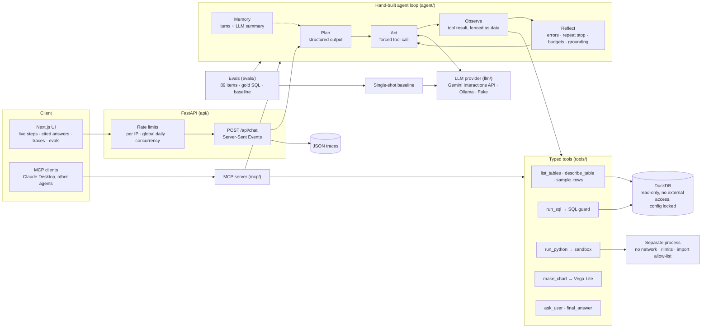

# Architecture

## Modules

| Path | Responsibility |
|---|---|
| `src/quarry/data/` | Download the public dataset, verify checksums, build the typed DuckDB warehouse with column comments, write `docs/schema.md`. |
| `src/quarry/tools/` | The tools, the read-only database wrapper (`db.py`), the SQL checker (`sql_guard.py`), result fencing and citation checking. |
| `src/quarry/sandbox/` | `run_python`: static policy, process isolation, resource limits, the child runner. |
| `src/quarry/llm/` | Provider interface, Gemini (Interactions API), Ollama, a scripted fake, retries, pacing, pricing. |
| `src/quarry/agent/` | The loop, prompts, events, memory and traces. |
| `src/quarry/evals/` | Benchmark, gold results, matcher, baseline, runner, report, oracle fakes. |
| `src/quarry/api/` | FastAPI app, SSE streaming, rate limiting. |
| `src/quarry/mcp/` | MCP server over stdio. |
| `web/` | Next.js UI (static export served by the API). |

## One run, step by step

1. **Plan.** One call with a JSON schema returns 2-5 steps. The plan is shown to the user and
   handed to the next call as a draft the model may revise.
2. **Act.** Each turn the model must call at least one tool (`tool_choice` is "required"). Text
   it writes next to a call is surfaced as its reasoning.
3. **Observe.** Tool arguments are validated by pydantic; a bad call becomes a readable error,
   never an exception. Results that contain database text are wrapped in a fence with a
   per-run random id.
4. **Reflect.** A failed call comes back with the error and a prompt to diagnose it before
   retrying. The same call failing twice with the same error stops the run. Five failures in a
   row stop the run. `final_answer` is checked against the data: every cited number must
   appear in the cited result; a rejected answer goes back for correction twice and is then
   accepted with the unverified numbers flagged.
5. **Budgets.** After `max_steps` or `max_total_tokens` the loop forces `final_answer`.
6. **Memory.** Each turn keeps the question, the outcome, the answer and the SQL that mattered.
   Older turns are folded into an LLM summary when the memory grows. A reply to a clarifying
   question is merged back into the original question.
7. **Trace.** Every event (plan, each model call with tokens, latency and cost, each tool call
   with its input, output and error) streams to the UI and is saved as JSON.
